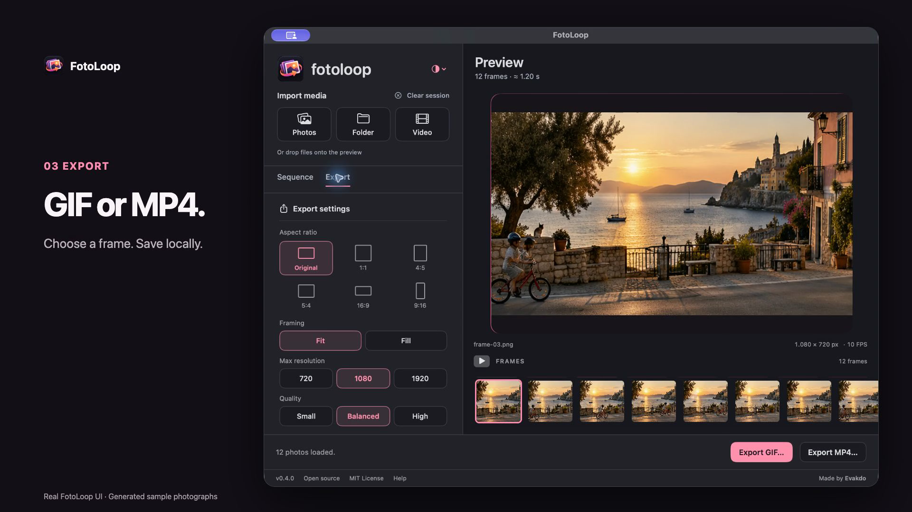

<div align='center'>
  
  <h1>FotoLoop</h1>
  <p>Turn photo sequences or video clips into a GIF or MP4 on your Mac.</p>
  <p>Native macOS · Offline · Free and open source</p>
  <p><a href='#getting-started'>Get started</a> · <a href='#features'>Features</a> · <a href='README.pt-BR.md'>Português</a></p>
</div>

FotoLoop is a small macOS app for animating photo sequences or turning a short video segment into a GIF or MP4. Adjust the timing and framing, then export. Your media stays on your Mac.

## Preview

[](docs/media/fotoloop-demo.mp4)

[Watch the 12-second demo](docs/media/fotoloop-demo.mp4). It combines captures of the current app with generated sample photographs.

<details>
<summary>See earlier app screenshots</summary>


</details>

## Getting started

**Current release: source code.** There is no DMG or Homebrew package for FotoLoop yet. Homebrew is used below only to install FFmpeg, which the app needs for export.

Requirements: macOS 13 or later, a Swift 5.9+ toolchain with the macOS SDK, and FFmpeg with `libx264` and FFprobe. This version was built on an Apple Silicon Mac; Intel Macs and macOS 13 hardware have not been verified.

1. Install Apple's Command Line Tools with `xcode-select --install` (or use Xcode). If you do not have Homebrew, follow the instructions at [brew.sh](https://brew.sh/).
2. Install FFmpeg, then clone and build FotoLoop:

   ```sh
   brew install ffmpeg
   git clone https://github.com/evaldopedrosa/FotoLoop.git
   cd FotoLoop/Desenvolvimento
   ./scripts/build-app.sh
   open ../Aplicativo/FotoLoop.app
   ```

The build script creates `Aplicativo/FotoLoop.app` with the project icon. To keep it in your Applications folder, move the app there with Finder. The generated app is ignored by Git.

FotoLoop looks for FFmpeg at `/opt/homebrew/bin/ffmpeg`, `/usr/local/bin/ffmpeg`, or `/usr/bin/ffmpeg`. A copy installed elsewhere is not detected automatically.

## Features

- Import JPG, PNG, and HEIC images, including folders with subfolders, in natural filename order. Drag files or folders from Finder onto the preview, or use the import buttons in the sidebar.
- Import one video (such as MP4 or MOV), choose a segment up to 30 seconds, and turn it into frames. Video and photos use separate sessions.
- Reorder photos by dragging thumbnails or using the arrow buttons.
- Set a pace from 4 to 30 source frames per second with a slider, choose Forward, Reverse, or Ping-pong, and repeat the full sequence 1–20 times. GIF playback loops independently of these repetitions.
- For video, changing FPS resamples the selected segment: lower values create a more stepped motion while keeping roughly the same source duration. **Hold each frame** (1–4×) lengthens playback independently. Your original video is preserved.
- Preview with play/pause and a visual frame strip; select a frame in the strip or reorder with the native frame list.
- Choose the original aspect ratio, 1:1, 4:5, 5:4, 16:9, or 9:16 from visual presets. Fit the whole image with margins or fill the canvas with a centered crop.
- Preview the result, choose resolution and quality, and clear the session to start again.
- Follow the macOS appearance or choose a saved light or dark preference.
- See the app icon, version, open-source credit, bundled MIT license, and quick help inside the app.

### Basic workflow

1. Drop photos or a folder onto the preview, or use Photos / Folder in the sidebar.
2. Drag thumbnails into order, or select one and use the arrows.
3. Set FPS, direction, and repeats in Sequence; choose aspect ratio, framing, resolution, and quality in Export.
4. Export a GIF or MP4. Clear the session when you want to begin another sequence.

For video, use **Video** or drop a file onto the preview. Choose the start and length of the segment, then adjust FPS and **Hold each frame** in Sequence. Export uses the same aspect ratio, framing, resolution, quality, and direction controls as photo sequences. Extracted frames are temporary and are removed when you clear the session.

**Fit (Ajustar)** keeps the entire photo and adds black margins where needed. **Fill (Preencher)** crops from the center without stretching. Every frame in the exported file has consistent dimensions. GIF timing is rounded to hundredths of a second; MP4 files use a 30 fps output stream.

## Built for a small, offline workflow

The interface uses SwiftUI and AppKit, ImageIO reads the frames, and external FFmpeg/FFprobe executables handle video input and encoding. There are no accounts, analytics, network features, or third-party Swift packages. The app interface is in English.

## Source and verification

| Path | Purpose | In Git |
| --- | --- | --- |
| `Desenvolvimento/` | SwiftPM source, tests, and build scripts | Yes, excluding build caches and `work/` |
| `Design/` | App icon artwork and macOS icon file | Yes |
| `Aplicativo/` | Locally built app | Only the folder guide; the `.app` is ignored |
| `docs/` | Demo video, cover, and screenshots | Yes |

Run the automated tests with:

```sh
cd Desenvolvimento
./scripts/test.sh
```

The test suite uses synthetic images and checks import, ordering, sessions, framing, and actual GIF/MP4 output across 42 export combinations, plus reverse GIF order. Import, drag-and-drop, export through the macOS save panels, and starting a new session were checked in the previous app version with synthetic images.

[Performance notes](PERFORMANCE.md) document the local measurements and their limits. They do not claim a measured improvement in whole-app frame rate or memory use.

## Current limits

- The app has not been signed or notarized for distribution. There is no downloadable installer yet.
- Intel Macs and a physical macOS 13 machine have not been tested.
- Export cannot be cancelled once encoding starts. The crop stays centered; sessions are not saved.
- A cold preview cache can skip frames in demanding sequences.

## Credits and license

Made by **Evakdo 🇧🇷**. Licensed under [MIT](LICENSE).
