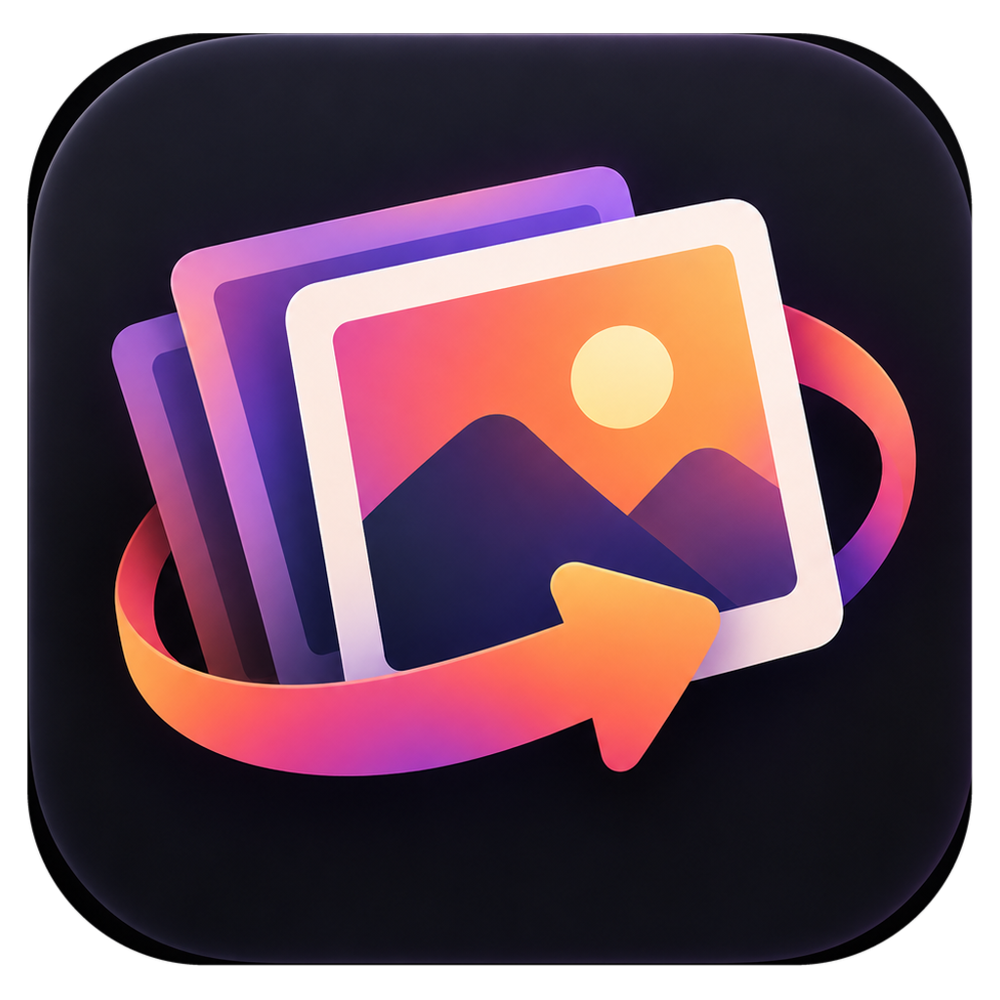
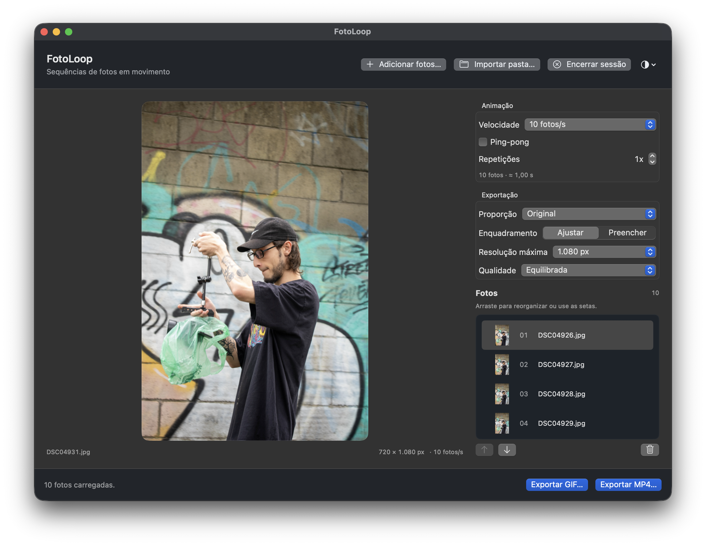
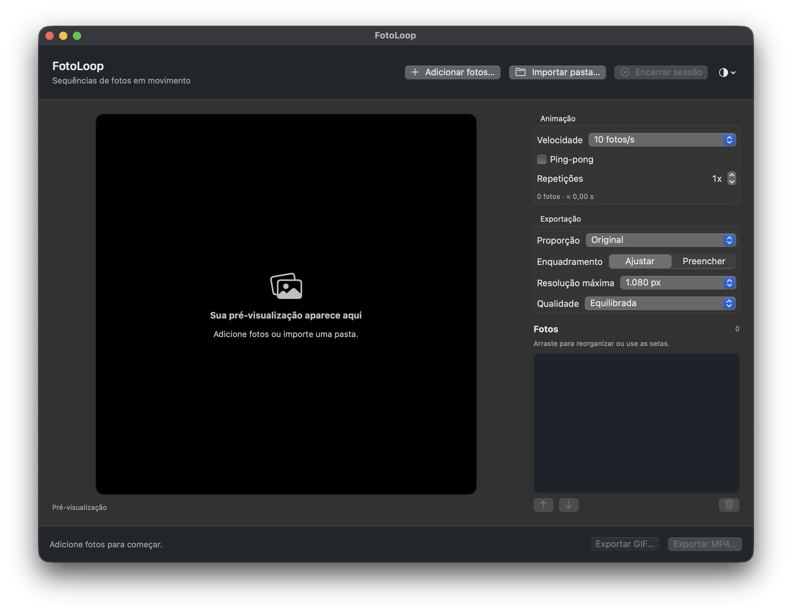

# FotoLoop

[English](README.md) · Português



FotoLoop é um app nativo e offline para transformar uma sequência de fotografias em GIF ou MP4. Escolha as fotos, ajuste o ritmo e exporte. Os arquivos permanecem no seu Mac.

## Prévia



<details>
<summary>Ver a tela inicial</summary>



</details>

## O que faz

- Importa JPG, PNG e HEIC, inclusive pastas com subpastas, em ordem natural.
- Permite reorganizar as fotos por arrastar e soltar ou pelos botões de seta.
- Oferece 4 a 30 fotos/s, ping-pong e 1 a 20 repetições da sequência. O loop infinito do GIF é independente dessas repetições.
- Exporta no formato original ou nas proporções 1:1, 4:5, 5:4, 16:9 e 9:16, ajustando a foto inteira ou preenchendo o quadro com corte central.
- Mostra a prévia e permite encerrar a sessão para começar outra sem reiniciar.
- Acompanha o modo claro/escuro do macOS ou usa uma preferência salva.

O app usa SwiftUI e AppKit na interface, ImageIO para ler as fotos e FFmpeg para codificar os arquivos. Não há conta, rede, analytics nem pacotes Swift de terceiros.

## Começar

**Distribuição atual: código-fonte.** Ainda não existe DMG nem pacote Homebrew para o FotoLoop. O Homebrew é usado aqui apenas para instalar o FFmpeg, necessário para exportar.

Requisitos: macOS 13 ou posterior, Swift 5.9+ com o SDK do macOS e FFmpeg com `libx264`. Esta versão foi compilada e verificada em um Mac Apple Silicon; ainda não foi validada em Intel ou em um Mac físico com macOS 13.

1. Instale as Ferramentas de Linha de Comando da Apple com `xcode-select --install` (ou use o Xcode). Se ainda não tiver o Homebrew, siga as instruções em [brew.sh](https://brew.sh/).
2. Instale o FFmpeg, clone o repositório e compile o FotoLoop:

   ```sh
   brew install ffmpeg
   git clone https://github.com/evaldopedrosa/FotoLoop.git
   cd FotoLoop/Desenvolvimento
   ./scripts/build-app.sh
   open ../Aplicativo/FotoLoop.app
   ```

O script cria `Aplicativo/FotoLoop.app` com o ícone do projeto. Para mantê-lo na pasta Aplicativos, mova o app pelo Finder. O pacote gerado é ignorado pelo Git.

O FotoLoop procura o FFmpeg em `/opt/homebrew/bin/ffmpeg`, `/usr/local/bin/ffmpeg` ou `/usr/bin/ffmpeg`. Uma instalação em outro caminho não é detectada automaticamente.

## Uso

1. Adicione fotos ou importe uma pasta.
2. Arraste uma miniatura para a linha de inserção desejada, ou selecione-a e use as setas.
3. Ajuste velocidade, ping-pong, repetições, proporção, enquadramento, resolução e qualidade.
4. Exporte GIF ou MP4. Use **Encerrar sessão** para limpar a sequência e começar novamente.

**Ajustar** preserva a foto inteira, com margens pretas quando necessário. **Preencher** usa corte central sem distorção. Todas as fotos do arquivo usam as mesmas dimensões. A duração aproximada aparece na interface; o GIF usa tempos em centésimos de segundo e o MP4 sai a 30 quadros/s.

## Estrutura

| Pasta | Conteúdo | GitHub |
| --- | --- | --- |
| `Desenvolvimento/` | Código SwiftPM, testes e scripts | Código e scripts sim; `.build/` e `work/` não |
| `Aplicativo/` | App compilado para uso local | Apenas este guia; `FotoLoop.app` não |
| `Design/` | PNG, pacote de tamanhos e `.icns` do ícone | Sim |

`AGENTS.md`, `PERFORMANCE.md` e `LICENSE` acompanham o código. `HANDOFF.md`, caches, amostras sintéticas e arquivos antigos ficam somente no Mac.

## Testes e desempenho

```sh
cd Desenvolvimento
./scripts/test.sh
```

Os dez testes usam imagens sintéticas e verificam importação, sessão, ordem, enquadramento, cache e GIF/MP4 em 42 combinações de exportação. Importação, arrasto, exportação pelos painéis e nova sessão também foram verificados na interface com imagens sintéticas.

As medições e suas limitações estão em [PERFORMANCE.md](PERFORMANCE.md). Num ensaio isolado com 24 JPEGs de 6000 × 4000 px, a prévia com cache aquecido teve mediana 72% menor e a decodificação limitada à resolução de exportação teve mediana 78% menor. Isso não mede a melhora de FPS ou memória do app inteiro; o cache frio ainda pode causar perda de quadros na prévia.

## Limites conhecidos

- FFmpeg precisa estar instalado em um dos caminhos padrão indicados pelo app para exportar.
- A exportação mostra progresso na preparação e um indicador durante a codificação; ainda não oferece cancelamento.
- O corte é central, sem ajuste manual. O app não salva projetos nem sessões.
- A distribuição para outros Macs exigirá empacotamento e validação próprios.

Feito por **Evakdo 🇧🇷**. Licença [MIT](LICENSE).
